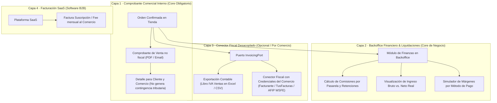
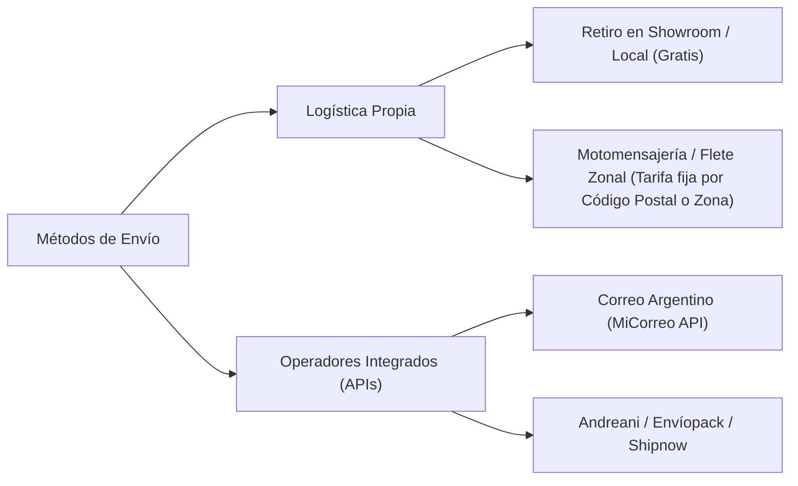

# Roadmap

## 1. Visión y Alcance del Producto: Plataforma eCommerce Multi-Comercio (White-Label / SaaS B2B)

El objetivo estratégico del proyecto es proveer un **producto de software de comercio electrónico escalable, modular y vendible para múltiples comercios independientes** (modelo multi-tenant / marca blanca).

Bajo las premisas inquebrantables de **Clean Architecture** y **Clean Code**:
1. **Núcleo de Dominio Desacoplado**: Las reglas de negocio (catálogo, variantes, inventario, precios, órdenes, carritos, cupones, promociones, cálculo de envíos y pagos) son puras, libres de dependencias de frameworks (Next.js), librerías de UI o servicios de terceros.
2. **Arquitectura Hexagonal (Puertos y Adaptadores)**: Los proveedores externos de pago (Mercado Pago, Stripe, transferencias bancarias), operadores logísticos (Correo Argentino, Andreani, Envíopack, motomensajería) y servicios de facturación/notificación se integran como adaptadores intercambiables tras interfaces estables (`PaymentGatewayPort`, `ShippingCarrierPort`, `InvoicingPort`, `NotificationPort`).
3. **Aislamiento Multi-Comercio (Multi-Tenancy)**: Toda transacción, producto, orden, cupón y configuración operativa está segregada por comercio (`commerce_id`). Cada cliente comercial puede operar con:
   - Su propia identidad visual (nombre, logotipo, paletas de colores dinámicas, fuentes tipográficas).
   - Su propio catálogo, categorías y control de inventario.
   - Sus propios métodos de pago activos con credenciales y cuentas bancarias independientes.
   - Sus propias reglas logísticas, puntos de retiro y zonas de envío.
   - Su propio panel de métricas, pedidos y clientes registrados.
4. **Principios SOLID y Clean Code**:
   - **SRP (Single Responsibility)**: Servicios y casos de uso con un único motivo de cambio.
   - **OCP (Open/Closed)**: Nuevos métodos de pago o transportistas se agregan implementando adaptadores sin modificar el código del checkout ni la lógica de órdenes.
   - **DIP (Dependency Inversion)**: Los casos de uso dependen de abstracciones (puertos de dominio), nunca de implementaciones concretas de infraestructura.

---

## 2. Matriz de Fases del Roadmap

| Fase | Entregable | Reglas | Tag | Estado |
|---|---|---|---|---|
| **0 · Fundación** | Repositorio, arquitectura base, documentación viva, CI/CD, deploy Cloudflare Pages/Workers, variables de entorno validadas con Zod | AR-04 | `v0.1.0` | **Completada** |
| **1 · Núcleo de datos** | Schema D1 y migraciones versionadas Drizzle, seed de categorías, parser de texto libre, jerarquía de variantes (colores, talles y stock atómico), servicios `createProduct`, `listProducts` (filtros, orden, paginación), `changeStatus`; tests unitarios | BR-01 a 06, 15 a 21, 23 | `v0.2.0` | **Completada** |
| **2 · Catálogo público** | Home editorial, carrusel responsivo, grilla, filtros y orden reflejados en URL, búsqueda por código (`#001`), ficha de producto con URL canónica estable, selector interactivo de color y talle con tope de stock físico, Open Graph, telemetría desacoplada de visitas y clics de WhatsApp, navegación fluida SPA y loading spinner accesible | BR-09, 13, 16, 20 a 24, 38, 39, AR-07, AR-11 | `v0.3.0` | **Completada** |
| **3 · Auth + backoffice base** | Login seguro con hashing salado PBKDF2-HMAC-SHA512 (100.000 iteraciones), jerarquía de roles `SUPER_ADMIN` y `ADMIN`, rate-limiting contra fuerza bruta en DB, resumen con contadores de inventario, carga rápida con vista previa interactiva y parser, lista de productos con métricas, cambio de estado con historial y deshacer (*undo*) | BR-07, 08, 10, 11, 25 a 28, 36, 37, 39 | `v0.4.0` | **Completada** |
| **4 · Backoffice avanzado, Categorías, Temas & Store Global** | Gestión completa de categorías (árbol jerárquico 2 niveles, reordenamiento manual, protección de borrado), acciones en lote (`BR-29`), personalización de showroom sin deploy (logo, colores, paletas dinámicas, selector de fuentes tipográficas por comercio, portada con banner), y Zustand como store global (`useBackofficeStore`) | BR-17, 18, 29, 33, 34, 35, AR-10 | `v0.5.0` | **Completada** |
| **5 · Carrito, Órdenes, Portal de Cliente `/cuenta` y Mesa de Postventa** | Carrito multi-producto con tope de stock físico en cliente; checkout en pasos (*stepper* `/carrito`); generación de orden correlativa atómica (`#ORD-xxx`) y adaptador de checkout multi-producto para WhatsApp; autenticación y registro de clientes con cookie firmada independiente (`aura_customer_session`); portal `/cuenta` con historial de pedidos y libreta de direcciones (`customer_addresses`); vinculación automática de compras previas; mesa de control de calidad y botón de arrepentimiento legal (Res. 424/2020) con recirculación de stock en backoffice; búsqueda omnicanal en pedidos por DNI, código, fechas y entrega | BR-40, 41, 42, 45, 46, AR-10, AR-12, AR-14 | `v0.6.0` | **Completada** |
| **6 · Marketing: Cupones Jerarquizados, Anuncios & Popups Promocionales** | **Parte 6.1 (Completada)**: Portal de Descuentos, motor de cupones con jerarquía estricta (`ALL_STORE`, `CATEGORY`, `SELECTED_PRODUCTS`), tipos porcentaje/monto fijo, validación antifraude (triangulación email, teléfono, DNI), canjes registrados y panel `/admin/descuentos`.<br>**Parte 6.2 (En curso / Refinada)**: Cintillo superior de anuncios (*Announcement Bar*) rotativo/fijo configurable en storefront; modal/popup promocional de bienvenida con control de frecuencia estricto en cliente (`localStorage`) para prevenir fatiga visual; analítica de conversión de promociones | BR-43, 44, AR-13, AR-15 | `v0.7.0` | **En curso / Refinada** |
| **7 · Discovery & Arquitectura Multi-Pasarela de Pagos (Mercado Pago, Stripe, Transferencia, Efectivo)** | Discovery técnico y financiero de métodos de pago; interfaz `PaymentGatewayPort` en dominio; soporte de Mercado Pago (Checkout Pro y Checkout Transparente), Stripe (tarjetas internacionales, Apple/Google Pay), Transferencia Bancaria (CBU/CVU/Alias con carga de comprobante y bonificación configurable), y Efectivo contra entrega / Retiro en local; webhooks idempotentes, cambio atómico a `PAID` y conciliación de stock | BR-14, 47, AR-14, AR-16 | `v0.8.0` | **Planificada** |
| **8 · Backoffice Financiero, Control de Costos, Comisiones y Marco Legal de Facturación** | Discovery legal y tributario (AFIP / ARCA, comprobantes internos vs. fiscales); panel de finanzas en backoffice con cálculo de comisiones por pasarela, retenciones estimadas e ingreso neto real por orden; simulador de costos para el comerciante; emisión de Comprobante de Venta no fiscal (PDF/email); puerto desacoplado `InvoicingPort` para exportación contable (IVA Ventas) o conexión opcional con conectores fiscales delegados (Facturante / TusFacturas / WSFE) con CUIT del comercio | BR-48, 49, AR-18 | `v0.9.0` | **Planificada** |
| **9 · Métodos de Envío, Integraciones Logísticas y Tracking de Pedidos** | Discovery de operadores logísticos (Correo Argentino MiCorreo, Andreani, Envíopack, Shipnow, fletes locales); puerto `ShippingCarrierPort`; cotización dinámica de flete por código postal, peso y volumen; generación e impresión de etiquetas de despacho en backoffice; tracking de envíos con estados normalizados y portal de seguimiento en tiempo real para el cliente | BR-41, 50, AR-17 | `v1.0.0` | **Planificada** |
| **10 · Multi-Comercio SaaS B2B, Ciclo de Vida y Hardening de Producción** | Tenant scoping multi-comercio completo (`commerceId`), dominios personalizados (*Custom Domains* con Cloudflare for SaaS / CNAME), facturación B2B de la plataforma al comercio (suscripción SaaS), ciclo de vida con reservas expiradas (`reservation_hours`), purga automática de agotados tras 30 días con modo *dry-run*, auditoría de seguridad y hardening | BR-04, 30, 31, 32, 51, AR-19 | `v1.1.0` | **Planificada** |

---

## 3. Refinamiento en Detalle de la Fase 6 (Marketing, Anuncios y Promociones)

Dado que la Fase 6 requería clarificación respecto a qué partes están implementadas y cuáles pendientes de finalización:

### 3.1. Lo ya construido (Parte 6.1 · Portal de Descuentos y Cupones)
- **Esquema de datos Drizzle y Migración SQL**: Tablas `coupons` y `coupon_redemptions` con soporte para límites globales, límite por cliente, vigencias temporales (`startsAt`, `expiresAt`) y topes de descuento en pesos.
- **Motor de Dominio Puro**: Validación estricta de alcance (`ALL_STORE`, `CATEGORY`, `SELECTED_PRODUCTS`) y cálculo desacoplado en centavos.
- **Triangulación Antifraude**: Detección y bloqueo de reutilización indebida de cupones mediante correlación cruzada de `customerEmail`, `customerPhone` y `customerDni`.
- **Panel Backoffice de Gestión**: Módulo `/admin/descuentos` con tabla de cupones, conmutación de estado activo/pausado, métricas de usos y modal de alta.
- **Integración en Carrito**: Endpoint `/api/coupons/validate` y consumo reactivo en `/carrito`.

### 3.2. Lo pendiente por construir y refinar (Parte 6.2 · Anuncios y Popups)
- **Cintillo Superior de Anuncios (*Announcement Bar*)**:
  - Componente accesible en la cabecera del storefront (`src/components/announcement-bar.tsx`).
  - Capacidad de alternar múltiples mensajes rotativos o mensaje fijo (ej: *"3 cuotas sin interés con Mercado Pago"*, *"Envío gratis superando $80.000"*).
  - Enlaces opcionales de redirección a categorías o colecciones específicas.
  - Colores de fondo y tipografía personalizables desde la configuración del comercio.
- **Modal / Popup Promocional de Bienvenida**:
  - Modal editorial desacoplado con oferta destacada (ej: cupón de primera compra `BIENVENIDA10`).
  - **Control estricto de frecuencia en cliente (`localStorage`)**: Almacena el timestamp de descarte o suscripción para no reabrir el popup en visitas subsiguientes dentro de un período configurable (ej: 7 o 14 días), evitando penalizaciones en Core Web Vitals (CLS) y respetando la experiencia de usuario.
  - Configuración desde el Backoffice (activar/pausar, título, descripción, imagen opcional, cupón asociado).
- **Métricas de Promociones en Backoffice**:
  - Visualización del impacto económico de los descuentos aplicados: total bonificado en pesos vs. volumen de ventas generado gracias a cupones.

---

## 4. Discovery & Arquitectura Multi-Pasarela de Pagos (Fase 7)

Para satisfacer la venta del software a diversos comercios, la plataforma no debe depender exclusivamente de Mercado Pago. Se implementa una **estrategia multi-pasarela bajo Clean Architecture**.

### 4.1. Discovery de Métodos de Pago: Comparativa Técnica y Comercial

| Método de Pago | Tipo | Comisión Estimada (Mercado AR) | Plazo Acreditación | Ventajas Clave | Desventajas / Requisitos |
|---|---|---|---|---|---|
| **Mercado Pago** (Checkout Pro / Transparente) | Pasarela Online | ~6.39% + IVA (inmediato)<br>~3.19% + IVA (14 días)<br>~1.99% + IVA (30 días) | Inmediato a 30 días | Máxima familiaridad en Argentina, dinero en cuenta, cuotas con tarjeta, débito | Comisiones elevadas para el comerciante, retenciones impositivas automáticas |
| **Transferencia Bancaria Directa** (CBU/CVU/Alias) | Directo / Manual | **0%** (Sin comisiones) | Inmediato | Dinero directo en la cuenta del comercio, permite ofrecer descuentos atractivos (ej: 10% OFF) | Conciliación manual o validación de comprobante subido por el comprador |
| **Stripe** | Pasarela Online | ~3.9% + $0.30 USD | 2 a 7 días hábiles | Estándar global para cobros internacionales (USD/EUR), Apple Pay, Google Pay | Requiere cuenta bancaria habilitada en EE.UU., Europa o jurisdicción soportada |
| **Efectivo / Pago al Retirar** | Offline / Local | **0%** (Sin comisiones) | Al momento de la entrega | Cero fricción para clientes locales en showroom o motomensajería | Riesgo de pedidos no retirados / cancelados |
| **Otras Pasarelas Regionales** (Mobbex / Ualá Bis / Nave) | Pasarela Online | ~3.5% a 5% + IVA | Inmediato a 48 hs | Tarifas competitivas, promociones bancarias específicas | Integraciones de API propietarias adicionales |

### 4.2. Diseño de Arquitectura Limpia para Pagos

```text
src/domain/payment/
  ├── ports/
  │   └── payment-gateway.port.ts    → Interfaz agnóstica de pagos
  ├── types.ts                      → Estados (PENDING, PAID, REJECTED, REFUNDED)
  └── rules.ts                      → Reglas de bonificación y validación

src/infra/payments/
  ├── mercadopago/
  │   └── mercadopago.adapter.ts    → Implementación Checkout Pro / Webhooks
  ├── stripe/
  │   └── stripe.adapter.ts         → Implementación Checkout Session / Elements
  ├── bank-transfer/
  │   └── bank-transfer.adapter.ts  → Instrucciones CBU/CVU y gestión de comprobantes
  ├── cash/
  │   └── cash-on-delivery.adapter.ts → Pago en punto de entrega
  └── whatsapp/
      └── whatsapp.adapter.ts       → Checkout asistido (existente)
```

- **Puerto `PaymentGatewayPort`**:
  ```typescript
  export interface PaymentGatewayPort {
    readonly providerId: string;
    createPaymentPreference(order: Order, options?: PaymentOptions): Promise<PaymentPreferenceResult>;
    processWebhook(payload: unknown, headers: Record<string, string>): Promise<WebhookProcessResult>;
    verifyPaymentStatus(externalId: string): Promise<PaymentStatusResult>;
    refund(orderId: number, amountCents?: number): Promise<RefundResult>;
  }
  ```
- **Descuentos y Recargos por Método de Pago**:
  - Cada comercio puede configurar una bonificación porcentual por método (ej: *10% de descuento abonando por Transferencia Bancaria*).
  - El motor de checkout recalcula el total dinámicamente antes de confirmar la orden.
- **Confirmación y Stock**:
  - Pagos online: la acreditación confirmada por webhook dispara la transición atómica de la orden a `PAID` y bloquea/descuenta el stock definitivamente en base de datos.
  - Transferencias: la orden se crea en estado `PENDING` reservando stock temporalmente; el cliente sube su comprobante y la administradora confirma el cobro desde el panel para pasar a `PAID`.

---

## 5. Módulo Financiero en Backoffice & Marco Legal de Facturación (Fase 8)

### 5.1. Observación Legal y Regulatoria de la Facturación en un Producto Multi-Comercio

> [!WARNING] Responsabilidad Tributaria y Riesgo Legal
> En Argentina (AFIP / ARCA) y en el comercio internacional, **cada comercio vendedor es una persona física o jurídica con condición tributaria propia e independiente** (Monotributista, Responsable Inscripto, Exento, SRL, SA).
> Emitir facturas fiscales directamente desde un software centralizado sin un mandato formal de facturación delegada implicaría asumir contingencias fiscales y responsabilidades solidarias indebidas para la plataforma de software.

Por esta razón, la arquitectura desacopla estrictamente los conceptos financieros y fiscales en **cuatro capas bien delimitadas**:



### 5.2. Especificación de los Componentes Financieros y de Facturación

1. **Comprobante de Compra / Nota de Venta (No fiscal · Alcance Core)**:
   - Emisión automática tras confirmación de la orden (`#ORD-xxx`).
   - Generación de PDF accesible y envío adjunto por correo electrónico al comprador y al comercio.
   - Contiene: Logotipo y datos comerciales del comercio, fecha, número de orden, detalle de prendas, subtotales, descuentos, costo de logística, total abonado y método de pago utilizado.
   - Leyenda legal estándar: *"Documento no válido como factura fiscal. Emitido como constancia de pedido y comprobante de compra comercial"*.

2. **Panel de Finanzas y Control de Comisiones en Backoffice**:
   - **Métricas financieras en tiempo real**:
     - Ventas Brutas (*Gross Volume*).
     - Comisiones deducidas por pasarelas (costo Mercado Pago, costo Stripe, comisiones financieras).
     - Retenciones impositivas estimadas aplicadas por las pasarelas (IIBB, IVA, Ganancias según condición del comercio).
     - Costos logísticos cobrados al cliente vs. fletes abonados al operador.
     - **Ingreso Neto Real Liquidado** (*Net Payout* en mano del comercio).
   - **Simulador de Costos y Precios para el Comerciante**:
     - Herramienta interactiva para calcular rentabilidad: el comerciante ingresa el costo de la prenda y el sistema le muestra el margen neto real al cobrar por Transferencia (0%), Efectivo (0%) o Mercado Pago (3.19% / 6.39%).

3. **Conector Fiscal Desacoplado (`InvoicingPort`)**:
   - Para aquellos comercios que exijan emisión de factura electrónica legal (Facturas A, B o C en Argentina):
     - **Exportación Contable**: Descarga de reportes estructurados con formato compatible para su libro de IVA Ventas y presentación a su contador.
     - **Conectores Modulares**: La plataforma no procesa certificados en crudo en el núcleo; en su lugar, ofrece un conector opcional hacia APIs especializadas de facturación (ej: Facturante, TusFacturas.app o Web Service AFIP WSFE), donde cada comercio carga su propio certificado fiscal y punto de venta.

4. **Facturación de la Plataforma SaaS (B2B)**:
   - Facturación del software por el uso del servicio o suscripción mensual/anual directamente desde la empresa proveedora de la plataforma hacia los comercios clientes (gestionada independientemente con Stripe / Mercado Pago B2B).

---

## 6. Métodos de Envío, Integraciones Logísticas y Tracking (Fase 9)

El producto eCommerce debe permitir a cada comercio configurar una oferta logística versátil y competitiva.

### 6.1. Modalidades de Envío del Producto



### 6.2. Discovery de Operadores Logísticos en Argentina y la Región

| Operador / Plataforma | Cobertura | Cotización Dinámica | Etiquetas / Manifiesto | Tracking Webhook | Requisitos de Integración |
|---|---|---|---|---|---|
| **Correo Argentino** (MiCorreo) | Nacional (Sucursal y Domicilio) | Sí (por peso y CP de origen/destino) | Sí (PDF con código de barras) | Sí (Estados de distribución) | Cuenta comercial MiCorreo / API Key |
| **Andreani** | Nacional (Express y Clásico) | Sí (API REST Andreani) | Sí (ZPL / PDF térmico) | Sí (Webhooks en tiempo real) | Contrato Andreani / Token OAuth2 |
| **Envíopack / Shipnow** (Agregadores) | Multi-correo nacional | Sí (Compara tarifas de múltiples correos en 1 llamada) | Sí (Etiqueta unificada) | Sí (Consolida eventos de seguimiento) | Cuenta corporativa Envíopack |
| **Logística Propia / Zonal** | Local / Radio km | Tarifas manuales por tabla de CP | Remito de entrega interno | Actualización manual en backoffice | Ninguno (Sin costo de API) |

### 6.3. Arquitectura del Puerto Logístico (`ShippingCarrierPort`)

```text
src/domain/shipping/
  ├── ports/
  │   └── shipping-carrier.port.ts  → Interfaz agnóstica de logística
  ├── types.ts                     → Dimensiones, peso, tarifas y tracking
  └── rules.ts                     → Reglas de envío gratis y zonas

src/infra/shipping/
  ├── local/
  │   └── local-delivery.adapter.ts → Retiro en local y motomensajería zonal
  ├── correo-argentino/
  │   └── correo-argentino.adapter.ts → Cotización y etiquetas MiCorreo
  └── andreani/
      └── andreani.adapter.ts       → Cotización y tracking Andreani
```

- **Capacidades en Tienda y Backoffice**:
  - **Cotizador dinámico en el Carrito**: El comprador ingresa su Código Postal y visualiza opciones de entrega con plazo estimado de entrega y costo exacto.
  - **Envío Gratis Condicional**: Regla de negocio configurable por comercio (ej: *"Envío gratis en compras superiores a $75.000"*).
  - **Impresión de Etiquetas en Backoffice**: Generación con 1 clic de la etiqueta de despacho para pegar en el paquete.
  - **Portal de Tracking en Tiempo Real**: El cliente visualiza en `/cuenta` o mediante enlace público el estado de su envío (`PREPARANDO_PEDIDO`, `DESPACHADO`, `EN_DISTRIBUCION`, `ENTREGADO`).

---

## 7. Convención de Cierre y Commits por Fase del Roadmap

Al finalizar cada fase o entrega del roadmap, es **mandatorio** registrar los cambios aplicando de forma rigurosa la convención oficial definida en [docs/git-conventions.md](git-conventions.md):

1. **Commits Atómicos por Capa (Secuencia Canónica)**:
   - Prohibido consolidar toda una fase en un único commit masivo ("squash" ciego o "fase completa").
   - Los cambios deben registrarse secuencialmente por capa técnica:
     1. `docs:` Actualización de especificaciones funcionales, modelo de datos y reglas de negocio (`docs/business-rules.md`, `docs/data-model.md`, `docs/architecture.md`, `docs/roadmap.md`).
     2. `feat(db):` Esquemas Drizzle (`schema.ts`) y migraciones SQL versionadas (`drizzle/migrations/`).
     3. `feat(domain):` Entidades, tipos TypeScript puros (`src/domain/product/types.ts`) y reglas de negocio (`rules.ts`).
     4. `feat(services | payments | shipping | auth):` Servicios de aplicación, casos de uso y adaptadores de infraestructura (`src/services/`, `src/infra/`).
     5. `feat(catalog | backoffice):` Componentes de interfaz de usuario, páginas y feedback interactivo (`src/components/`, `src/app/`).
     6. `test:` Suites de pruebas automatizadas, fixtures y verificaciones (`tests/`).

2. **Formato y Propósito del Mensaje**:
   - Estructura obligatoria:
     ```text
     <tipo>(<ámbito>): <descripción concisa en minúsculas> [(BR-xx | AR-xx)]
     ```
   - Cumplir el principio rector: **"Se edita [X] para establecer funcionalidad para el objetivo [X]"** (evitar mensajes genéricos como *"ajustes de fase"* o *"update"*).
   - Indicar explícitamente las reglas de negocio (`BR-xx`) o de arquitectura (`AR-xx`) resueltas por el commit.

3. **Checklist Obligatorio de Aprobación Previa al Commit**:
   - [ ] Todos los tests de la suite en verde (`npm test` / `npx vitest run`).
   - [ ] Verificación de tipos y build de producción limpio (`npm run build`).
   - [ ] Sin archivos temporales, logs ni credenciales en el `git status`.

4. **Publicación de la Fase**:
   - Cada fase concluye formalmente con:
     - Pull Request hacia `main`.
     - CI en verde en el repositorio.
     - Deploy exitoso a producción.
     - Tag semántico correspondiente al roadmap (ej: `v0.1.0`, `v0.2.0`, `v0.6.0`, etc.) y Release documentado en GitHub.

---

## 8. Integración del Manejador de Estados (Evaluación Técnica)

### Selección: Zustand como estándar para Next.js 16 + React 19 (App Router)

Para la arquitectura moderna de Next.js basada en React Server Components (RSC) y Server Actions, se seleccionó **Zustand** como el manejador de estados más apto por las siguientes razones técnicas:

1. **Separación de responsabilidades con RSC**:
   - **Estado de Servidor**: Administrado directamente por Server Components, Drizzle ORM y base de datos Cloudflare D1. No se requiere un cliente pesado de caché tipo Redux o Apollo.
   - **Estado de Navegación/URL**: Filtros del catálogo, orden y búsqueda se mantienen en la URL (`searchParams` / `nuqs`) para preservar la indexación, SEO y URLs compartibles.
   - **Estado Global de Cliente (Zustand)**: UI compartida, selecciones en lote de backoffice, bolsa/carrito de prendas y estados de diálogos interactivos.

2. **Ventajas clave de Zustand frente a alternativas**:
   - **Peso ínfimo (~1.1 KB)** vs. Redux Toolkit (~32 KB) o MobX (~16 KB): impacto nulo en el First Input Delay y bundle inicial.
   - **Sin Context Providers anidados**: A diferencia de React Context tradicional, no obliga a envolver todo el árbol de la aplicación en `<Provider>` de cliente, evitando desoptimizaciones en el streaming de RSC y re-renders innecesarios.
   - **Compatibilidad nativa con React 19 y SSR**: Utiliza `useSyncExternalStore` internamente, eliminando errores de *hydration mismatch* (desfase entre cliente y servidor).
   - **Suscripciones atómicas**: Permite que los componentes solo se vuelvan a renderizar cuando cambia la porción exacta de estado que consumen mediante selectores simples (`useBackofficeStore(s => s.selectedProductIds)`).

### Casos de uso asignados en el proyecto

- **Fase 4 (Backoffice Avanzado · `v0.5.0`)**: Tienda `useBackofficeStore` para la selección múltiple de prendas en acciones en lote (`BR-29`), filtros rápidos en memoria y persistencia del estado de modales de edición.
- **Fase 5 (Carrito de compras & Checkout multi-prenda · `v0.6.0`)**: Tienda `useCartStore` para gestionar la bolsa de compras / selección de múltiples prendas y talles con control de inventario antes de disparar la reserva en WhatsApp o las pasarelas de pago.
